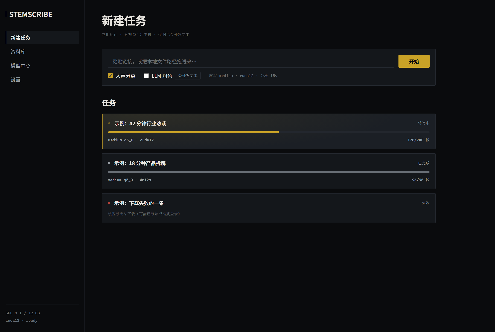
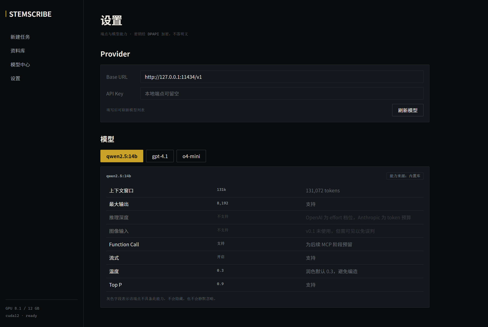
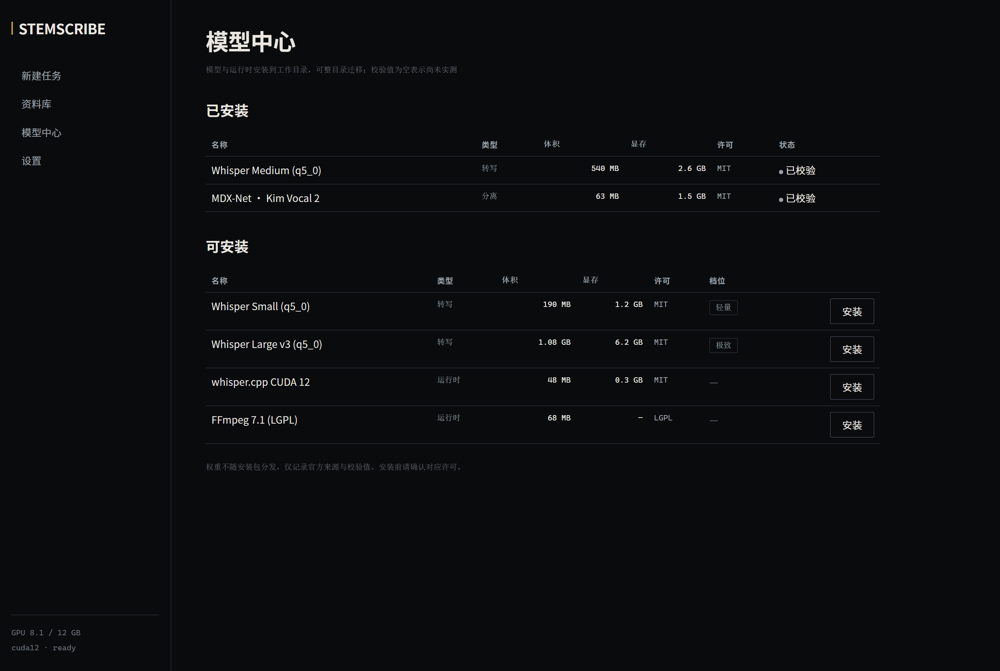

<p align="center">
  
</p>

<h1 align="center">Stemscribe</h1>

<p align="center">
  <b>Turn any video into an archival-grade transcript — entirely on your own GPU.</b><br>
  <sub>Local-first video → audio → text → polish pipeline for Windows. No cloud transcription.</sub>
</p>

<p align="center">
  <a href=".github/workflows/ci.yml"></a>
  
  
  
</p>

<p align="center"><a href="README.zh-CN.md">中文说明 →</a></p>

---

## Why this exists

The parts already exist: a Bilibili downloader, UVR for vocal separation, Whisper for
transcription, an LLM for cleanup. What does not exist is the **seam** — and the seam is
where all the work is.

| Before | Stemscribe |
|---|---|
| Four apps, files dragged by hand | One click, staged pipeline |
| Models scattered across `E:\` and `F:\` | One portable work directory, copy it anywhere |
| "Which model did I use last time?" | Provenance recorded per artifact |
| 200 episodes = 200 manual rounds | Batch queue, resumable, retry just the failures |
| Transcript stuck in a chat window | Structured bundle you can grep, back up, and hand to an agent |

## What it does

```
source ──► download ──► demux ──► separate ──► transcribe ──► align ──► polish ──► export
 (URL /                        (vocals /      (whisper.cpp,   (sentence   (optional   (bundle +
  file)                         instrumental)  GGML, on GPU)    repair)     LLM)        subtitles)
```

- **Local by default.** Audio and video never leave the machine. Only *text* may be sent to an LLM, and only when you switch polishing on.
- **You control the VRAM.** A budget-based scheduler reads real VRAM, keeps models resident (LRU), streams audio in segments, and downgrades explicitly: `CUDA → Vulkan → DirectML → CPU`. Downgrades are always surfaced with a reason — never silent.
- **Bring your own model.** whisper.cpp builds for CUDA / Vulkan / DirectML / CPU, installed on demand into your work directory with sha256 verification.
- **Bring your own LLM.** Any OpenAI-compatible endpoint (OpenAI, DeepSeek, Kimi, OpenRouter, Ollama, vLLM, LM Studio, one-api…) or Anthropic. Paste a URL and key, hit **Refresh**, pick a model.
- **Every capability is visible.** Context window, max output, reasoning depth, vision, tool calling, sampling — inspectable and editable per model, with unsupported fields **greyed out and explained** rather than hidden.
- **Reproducible artifacts.** Each episode is a self-contained directory; changing a parameter invalidates only the stages that depend on it.

## Screenshots

<table>
<tr>
<td width="50%"><br>
<sub><b>Provider settings.</b> Capability matrix per model. Unsupported fields are greyed out with a reason — the app never pretends a model can do something it cannot.</sub></td>
<td width="50%"><br>
<sub><b>Model centre.</b> Installed and installable runtimes/weights, with size, VRAM estimate and licence shown before you download.</sub></td>
</tr>
</table>

## Design

The interface is built from two art genes, and deliberately only two.

| | |
|---|---|
| **Swiss grid** (structure) | 12-column grid, one sans-serif family throughout, a four-step type scale (32 / 20 / 14 / 11), 1px hairlines, **one radius (2px)**, flat surfaces — hierarchy comes from surface tint and rules, never from drop shadows. |
| **Single light source** (focus) | A dark field where exactly one thing is lit: the task that is currently running gets a faint amber wash and a 2px left rule. Everything else stays in the dark. |
| **Palette** | Four colours, no more: ink `#0A0B0D`, graphite `#14171B`, bone `#E9E6E0`, amber `#C9A227`. |
| **Type** | Inter (UI), JetBrains Mono (timestamps, VRAM, token counts), Noto Sans SC. |

Why so austere: this is an instrument, not a dashboard. A progress bar that competes with
a finished bar for attention is a bug. Blue/purple gradients, glassmorphism, emoji status
icons and celebratory confetti are explicitly rejected — see
[`docs/UI-DESIGN.md`](docs/UI-DESIGN.md) for the full token set and the anti-pattern list.

## Install

> Status: **v0.0.x — scaffold**. Orchestration, artifacts and the UI shell work; real
> inference lands in CHG-0002. See [`docs/ROADMAP.md`](docs/ROADMAP.md).

Grab a release, unzip, run `stemscribe.exe`. It serves the embedded UI on loopback and
opens your browser (`127.0.0.1` only — nothing is exposed to the network).

- WebView2 runtime is already present on Windows 10 1803+ / Windows 11
- NVIDIA GPU optional — the CPU path always works
- **Unsigned build**: SmartScreen will warn. Verify against the release's `SHA256SUMS.txt`

## Build from source

```powershell
# Prerequisites: Go >= 1.23, Node >= 22, pnpm >= 11 (pnpm 11 requires Node >= 22.13)
pnpm --dir frontend install
.\scripts\build.ps1              # -> dist/stemscribe.exe (UI embedded, single file)
.\scripts\smoke-test.ps1         # 20 assertions over the bundle contract
bash scripts/verify-contract.sh  # CHG + docs + schemas
```

`stemscribe.exe` with no arguments opens the UI. The CLI stays available for automation:

```powershell
.\dist\stemscribe.exe run --input .\episode.mp4 --duration-ms 30000
.\dist\stemscribe.exe probe
```

## Architecture at a glance

| Layer | Choice |
|---|---|
| Shell | single Go binary; embedded static UI served on loopback (`Wails/WebView2` is the planned native shell — see ADR-001) |
| UI | Next.js 15 static export, design tokens in plain CSS |
| Inference | out-of-process engines over a JSONL protocol (`whisper.cpp`, `audio-separator`, `ffmpeg`) |
| Models | registry-declared, on-demand download, sha256 verified, atomically installed |
| Scheduling | VRAM budget → LRU residency → segmented streaming → four-level backend fallback |
| LLM | OpenAI-compatible + Anthropic adapters, three-tier capability resolution |
| Agent | local MCP server (search / get / context-pack), planned |

Details: [`docs/ARCHITECTURE.md`](docs/ARCHITECTURE.md) · decisions: [`docs/DECISIONS.md`](docs/DECISIONS.md)

## Documentation

| Doc | Contents |
|---|---|
| [`docs/ARCHITECTURE.md`](docs/ARCHITECTURE.md) | Layers, process model, IPC contract, error model |
| [`docs/PIPELINE.md`](docs/PIPELINE.md) | Stage DAG, idempotency, alignment repair, failure matrix |
| [`docs/MODEL-REGISTRY.md`](docs/MODEL-REGISTRY.md) | Registry schema, download/verify flow, licensing |
| [`docs/RESOURCE-SCHEDULER.md`](docs/RESOURCE-SCHEDULER.md) | VRAM budget, LRU, segmentation, RAM/IO strategy |
| [`docs/LLM-PROVIDERS.md`](docs/LLM-PROVIDERS.md) | Provider abstraction, capability resolution, parameter projection |
| [`docs/UI-DESIGN.md`](docs/UI-DESIGN.md) | Design genes, tokens, components, anti-patterns |
| [`docs/UPSTREAM-RESEARCH.md`](docs/UPSTREAM-RESEARCH.md) | What we borrowed from UVR / Buzz / WhisperDesktop |
| [`docs/ROADMAP.md`](docs/ROADMAP.md) | Milestones and change contracts |

## Credits

Stemscribe orchestrates other people's excellent work:
[whisper.cpp](https://github.com/ggml-org/whisper.cpp) ·
[Ultimate Vocal Remover](https://github.com/Anjok07/ultimatevocalremovergui) ·
[audio-separator](https://github.com/nomadkaraoke/python-audio-separator) ·
[Buzz](https://github.com/chidiwilliams/buzz) ·
[Const-me/Whisper](https://github.com/Const-me/Whisper) ·
[bilibili-video-downloader](https://github.com/lanyeeee/bilibili-video-downloader) ·
[FFmpeg](https://ffmpeg.org/)

**We do not redistribute third-party model weights.** The registry only records where to
get them and how to verify them.

## License

MIT — see [`LICENSE`](LICENSE). Please respect platform terms and copyright law: only
process material you have the right to process.
