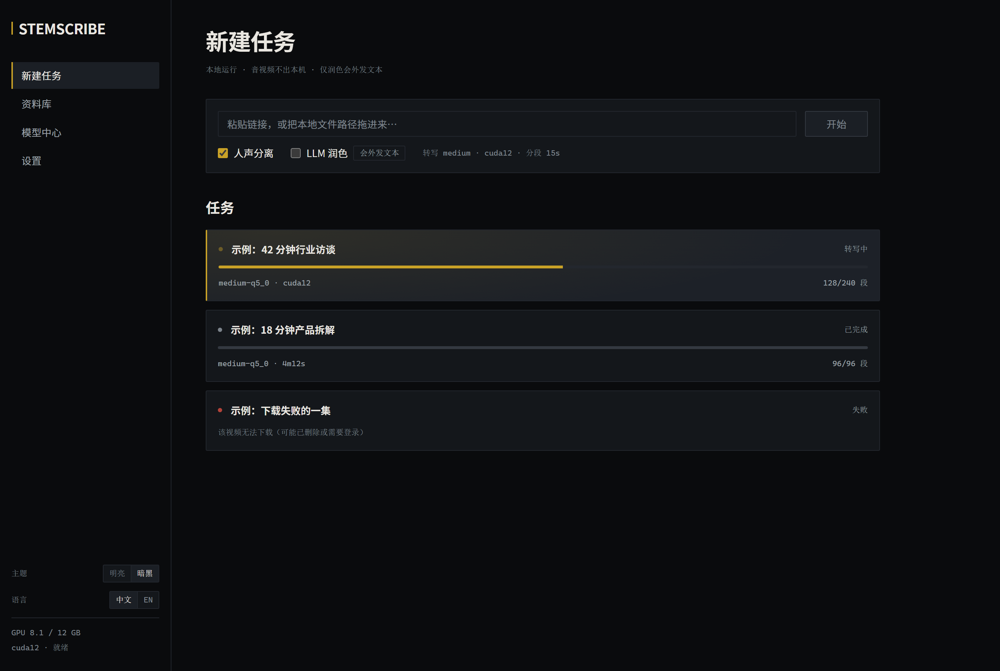
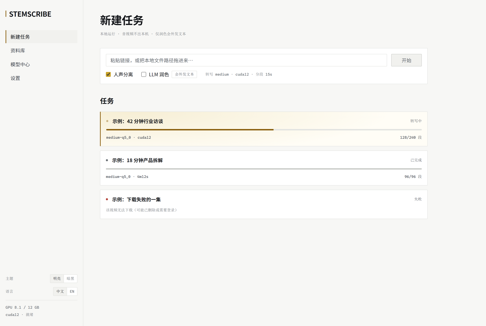
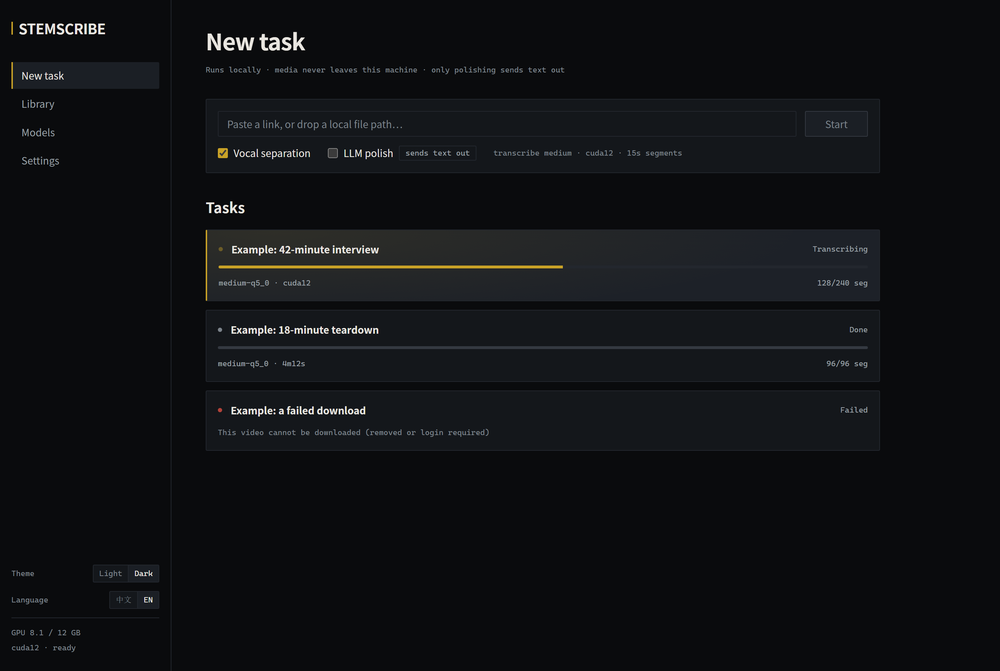
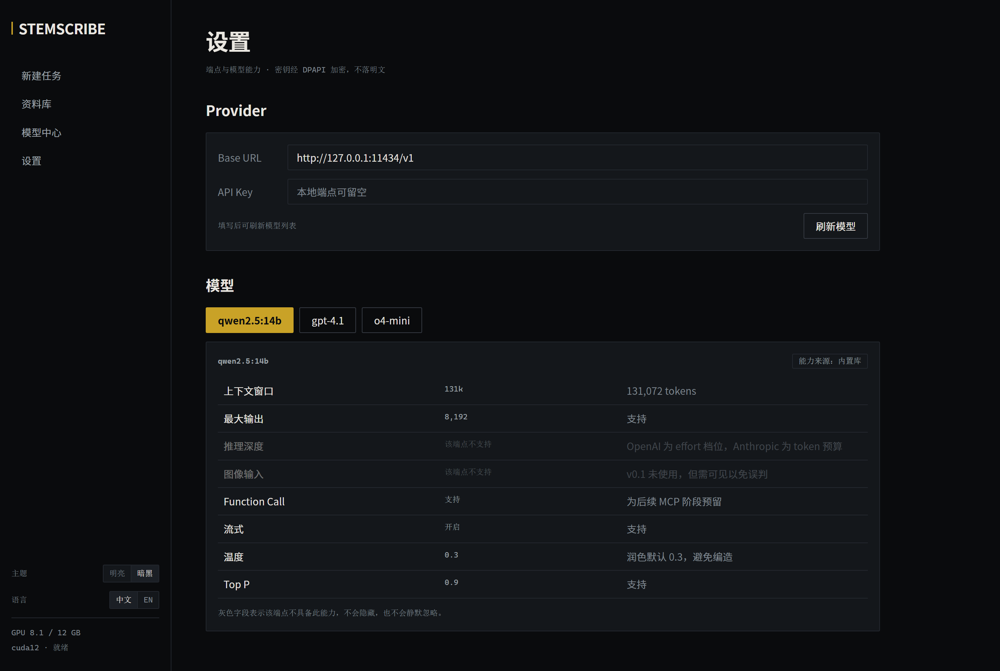
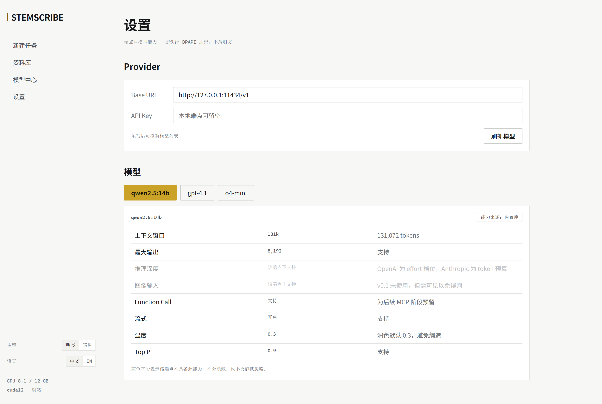
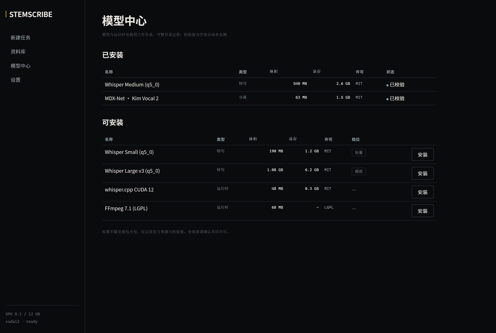

<h1 align="center">Stemscribe · 声轨抄录</h1>

<p align="center">
  <b>把任意视频变成一份可归档、可检索、可对话的文字稿——全程跑在你自己的显卡上。</b><br>
  <sub>面向 Windows 的本地优先流水线：视频 → 音频 → 文字 → 润色。不上传媒体、不开账号。</sub>
</p>

<p align="center">
  
  
</p>

<p align="center">
  <sub><b>两套主题，一套设计语言。</b>暗房用暗色，投影仪用明亮。中英双语，侧栏一键切换。</sub>
</p>

<p align="center">
  <a href=".github/workflows/ci.yml"></a>
  
  
  
  
</p>

<p align="center"><a href="README.md">English →</a></p>

---

## 为什么做这个

零件都已经有了：B 站下载器、UVR 提人声、Whisper 转写、LLM 润色。
缺的从来不是零件，而是**接缝**——而所有工作量都在接缝上。

| 现在 | 用 Stemscribe |
|---|---|
| 4 个软件，文件靠手拖 | 1 次点击，阶段化流水线 |
| 模型散在各个盘符 | 一个可整体搬走的工作目录 |
| 「上次用的哪个模型？」 | 每份产物记录引擎版本、模型指纹、参数快照 |
| 180 集要手工重复 180 次 | 批量队列，断点续跑，失败单条重试 |
| 稿子躺在聊天窗口里 | 结构化档案，可 grep、可备份、可直接交给 agent |

## 它做什么

```
来源 ──► 下载 ──► 抽轨 ──► 分离 ──► 转写 ──► 对齐 ──► 润色(可选) ──► 导出
(链接/                    (人声/伴奏)  (whisper.cpp  (句子     (任意 LLM)   (档案+字幕)
 本地文件)                              GGML，GPU 跑)  修复)
```

- **本地优先**：音视频字节永不出本机；只有**文本**可能发往 LLM，且必须由你显式开启。
- **显存自己管**：预算器读真实显存 → 模型 LRU 常驻 → 分段流式 → 四级降级（CUDA→Vulkan→DirectML→CPU）。每次降级都带原因，绝不静默。
- **模型自己装**：内置 registry 声明「去哪下、多大、sha256」，断点续传 + 校验 + 原子落盘，装到工作目录，可整目录迁移。
- **LLM 随你换**：填 URL + Key → 点「刷新」→ 拉模型列表。上下文窗口（常见 1M）、输出上限、推理深度、多模态、function call、采样参数全部可见可改；不支持的字段**置灰并说明原因**。
- **可复现**：每集一个自包含目录；改参数只让依赖它的阶段失效，不整集重跑。

## 双主题与双语

两者都是**一等公民**，不是给暗色界面后补的开关。

| | |
|---|---|
| **明亮** | 白天的瑞士网格：纸白底、发丝级分隔线、一个深琥珀强调色。给投影、打印、以及写进文档的截图用。 |
| **暗黑** | 同一张网格熄灯后：暗场里只有"正在跑的那件事"被一束暖光照亮。 |
| **中文 / English** | 所有可见文案来自**同一份带类型的字典**；任一语言缺 key，类型检查直接编译失败。 |
| **默认值** | 主题跟随系统，语言跟随浏览器；一旦手动切换就会被记住。 |
| **深链** | `?theme=light&lang=en` —— 截图与文档可确定性复现，且**不写回**你的偏好。 |

<p align="center">
  <br>
  <sub>英文界面（暗黑）。语言项 <code>中文</code> / <code>EN</code> 刻意保持原文不翻译。</sub>
</p>

## 设计（美术方案）

界面由**两个基因**构成，且刻意只用两个。

| | |
|---|---|
| **瑞士平面**（结构） | 12 列栅格、一家无衬线到底、四级字阶（32 / 20 / 14 / 11）、1px 细分隔、**唯一圆角 2px**、flat 无阴影——层级靠底色差与分隔线，不靠投影。 |
| **单一光源**（焦点） | 只照亮一件事：运行中的任务获得暖色受光面 + 2px 琥珀左竖线；已完成的工作退成发丝灰。 |
| **配色** | 每套主题 4 色。明亮：纸白 `#f7f7f5` / 纯白 / 墨 `#14161a` / 琥珀 `#8a5f0e`。暗黑：`#0a0b0d` / `#14171b` / 骨白 `#e9e6e0` / 琥珀 `#c9a227`。 |
| **字体** | Inter（界面）、JetBrains Mono（时间码/显存/token 数）、Noto Sans SC。 |

明亮主题**不是**暗色的反色——直接反色会得到发灰的白与发脏的黑，还会把"单一光源"的语义整个丢掉。
两套主题都是同一基因在不同光照下的推导，并且都过了对比度审计：

```
$ python scripts/contrast.py
light  text-3   #6b7076  #f7f7f5   4.66  PASS
dark   text-3   #7d848c  #0a0b0d   5.20  PASS
all pairs >= 4.5:1 in both themes
```

为什么这么克制：**这是仪表，不是后台面板**。一条"已完成"的进度条如果和"正在跑"的一样响，就是缺陷。
蓝紫渐变、玻璃拟态、emoji 状态图标、庆祝彩带一律不采用——完整 token 表见
[`docs/UI-DESIGN.md`](docs/UI-DESIGN.md) §14，反模式清单见 §11。

## 界面

<table>
<tr>
<td width="50%"><br>
<sub><b>Provider 设置（暗黑）。</b>每个模型一张能力矩阵；不支持的字段置灰并给出原因。</sub></td>
<td width="50%"><br>
<sub><b>Provider 设置（明亮）。</b>同一张矩阵在白底下的样子。不隐藏、不静默忽略。</sub></td>
</tr>
<tr>
<td width="50%"><br>
<sub><b>模型中心。</b>体积、显存估算、许可在下载前就可见。</sub></td>
<td width="50%">&nbsp;</td>
</tr>
</table>

## 安装

> 状态：**v0.0.x 骨架阶段**。编排、产物、主题与界面壳已可用；真实推理在 CHG-0002 落地。
> 进度见 [`docs/ROADMAP.md`](docs/ROADMAP.md)。

下载 release、解压、双击 `stemscribe.exe`。它把内嵌界面服务在回环地址并打开浏览器
（**仅 127.0.0.1**，不对局域网暴露任何东西）。

- WebView2 运行时在 Win10 1803+ / Win11 自带
- 没有 NVIDIA 显卡也能用（CPU 路径始终可用）
- **构建未签名**：SmartScreen 会警告。请用 release 附带的 `SHA256SUMS.txt` 校验

## 从源码构建

```powershell
# 前置：Go >= 1.23、Node >= 22、pnpm >= 11（pnpm 11 要求 Node >= 22.13）
pnpm --dir frontend install
.\scripts\build.ps1              # -> dist/stemscribe.exe（界面已内嵌，单文件）
.\scripts\smoke-test.ps1         # 20 条断言，覆盖产物契约
bash scripts/verify-contract.sh  # CHG + 文档 + schema
bash scripts/i18n-check.sh       # 主题 token + 语言 parity + 零硬编码中文
python scripts/contrast.py       # 两套主题的 WCAG AA 审计
```

`stemscribe.exe` 不带参数即打开界面；命令行仍保留给自动化用：

```powershell
.\dist\stemscribe.exe run --input .\episode.mp4 --duration-ms 30000
.\dist\stemscribe.exe probe
```

## 架构一览

| 层 | 选型 |
|---|---|
| 壳 | 单个 Go 二进制；内嵌静态界面，回环服务（`Wails/WebView2` 是计划中的原生壳，见 ADR-001） |
| 前端 | Next.js 15 静态导出，设计 token 用原生 CSS，不引 UI 框架 |
| i18n | 扁平类型化字典，语言 parity 在编译期强制（ADR-010） |
| 推理 | 外置引擎进程，JSONL 协议（`whisper.cpp` / `audio-separator` / `ffmpeg`） |
| 模型 | registry 声明 + 按需下载 + sha256 校验 + 原子安装 |
| 调度 | 显存预算 → LRU 常驻 → 分段流式 → 四级降级 |
| LLM | OpenAI-compatible + Anthropic 适配器，能力三层解析 |

详见 [`docs/ARCHITECTURE.md`](docs/ARCHITECTURE.md)；决策记录见 [`docs/DECISIONS.md`](docs/DECISIONS.md)。

## 文档

| 文档 | 内容 |
|---|---|
| [`docs/ARCHITECTURE.md`](docs/ARCHITECTURE.md) | 分层、进程模型、IPC 契约、错误模型 |
| [`docs/PIPELINE.md`](docs/PIPELINE.md) | 阶段 DAG、幂等续跑、对齐修复、失败矩阵 |
| [`docs/MODEL-REGISTRY.md`](docs/MODEL-REGISTRY.md) | registry schema、下载校验、许可合规 |
| [`docs/RESOURCE-SCHEDULER.md`](docs/RESOURCE-SCHEDULER.md) | 显存预算、LRU、分段、内存/IO 策略 |
| [`docs/LLM-PROVIDERS.md`](docs/LLM-PROVIDERS.md) | provider 抽象、能力解析、参数投影 |
| [`docs/UI-DESIGN.md`](docs/UI-DESIGN.md) | 设计基因、双主题 token 表、反模式 |
| [`docs/UPSTREAM-RESEARCH.md`](docs/UPSTREAM-RESEARCH.md) | 从 UVR / Buzz / WhisperDesktop 借鉴了什么 |
| [`tasks/CHG-0007/`](tasks/CHG-0007/) | 双主题与双语的变更契约 |

## 致谢

Stemscribe 做的是编排，功劳在别人：
[whisper.cpp](https://github.com/ggml-org/whisper.cpp) ·
[Ultimate Vocal Remover](https://github.com/Anjok07/ultimatevocalremovergui) ·
[audio-separator](https://github.com/nomadkaraoke/python-audio-separator) ·
[Buzz](https://github.com/chidiwilliams/buzz) ·
[Const-me/Whisper](https://github.com/Const-me/Whisper) ·
[bilibili-video-downloader](https://github.com/lanyeeee/bilibili-video-downloader) ·
[FFmpeg](https://ffmpeg.org/)

**本项目不再分发任何第三方模型权重。** registry 只记录去哪取、怎么校验。

## 许可

MIT，见 [`LICENSE`](LICENSE)。请遵守所在平台的服务条款与版权法规：只处理你有权处理的素材。
